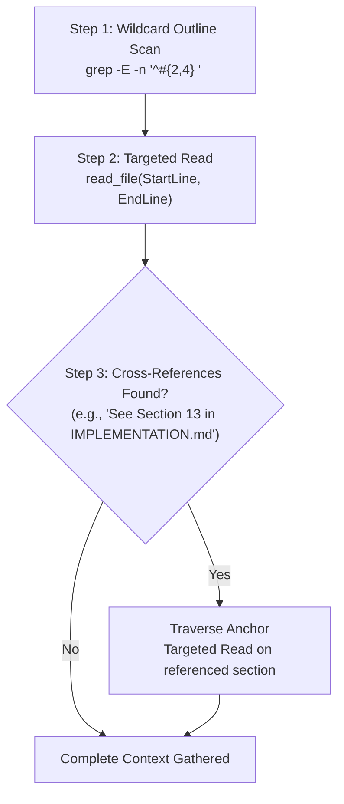

# Eudemonia Context Optimization & Targeted Reading Standard

This skill establishes best practices for AI agents and human developers when inspecting large specification and architecture documents in the Eudemonia repository.

---

## 1. Why Whole-File Reading Harms Agent Performance

The core markdown documentation files in Eudemonia contain extensive domain knowledge:

```
Document             Lines    Estimated Tokens   Primary Content
UX.md                 ~810       ~17,600         Component contracts, design tokens, ASCII wireframes
PRODUCT_SPEC.md       ~417       ~10,300         Requirements, user journeys, personas, NFRs
IMPLEMENTATION.md     ~300        ~8,000         Subsystem mechanics, prompt schemas, fix chronicle
TASKS_archive.md      ~682       ~15,000         Completed historical task records & test breakdowns
TASKS.md              ~330        ~5,500         Active milestone backlog & verification checklists
Total                2,539       ~56,400 tokens
```

Reading an 800-line file in a single tool call consumes **10%–20% of the active context window**, accelerating context window compaction and leading to forgotten instructions or hallucinated constraints.

---

## 2. Dynamic Wildcard Outline Search (Zero-Drift TOC)

Static written Tables of Contents inside Markdown files inevitably drift out of sync when headings are added, reordered, or edited. **Never rely on static TOC blocks.**

Instead, execute a **dynamic wildcard heading grep** to generate the real-time, 100% accurate structural map in 5ms:

```bash
# Generate full hierarchical outline (H2, H3, H4) across any document:
grep -E -n "^#{2,4} " PRODUCT_SPEC.md

# For UX contracts and screens (H2 and H3):
grep -E -n "^#{2,3} " UX.md

# For subsystem architecture and fix chronicle (H2 and H3):
grep -E -n "^#{2,3} " IMPLEMENTATION.md
```

### Why Wildcard Pattern Check Works:
- **`^#{2,4} `**: Matches `## Section`, `### Sub-section`, and `#### Requirement` in a single query.
- It returns line numbers alongside every heading (e.g. `161:#### FR1: Hardware Key Trigger`).
- It costs only **~150–250 tokens** (less than 1.5% of the file).
- The agent immediately has the **entire map of the document** with exact line ranges.

---

## 3. The 3-Step Context Retrieval Protocol



### Step 1: Scan Outline
Run `grep -E -n "^#{2,4} " <doc>` to locate the exact section and bounding line numbers.

### Step 2: Bounded Targeted Read
Call `read_file` with explicit bounds:
- **`StartLine`**: Beginning of the heading.
- **`EndLine`**: Beginning of the next heading (or end of subsection).

> [!IMPORTANT]
> **No Premature Blindfold Rule**:
> Line-range reading is a targeted retrieval mechanism, **not a rigid 30-line cutoff**. If a requirement or UI contract spans 80 lines or two related subsections, **read all of them**. Never stop reading prematurely if the behavioral contract is still unfolding.

### Step 3: Cross-Reference Traversal Rule
If the retrieved section states:
> *"Implemented via Delta Synthesis Engine in IMPLEMENTATION.md Section 13"*
> or *"Governed by FR1.3"*
The agent **must strictly follow that anchor** and perform a targeted read on the referenced section. This guarantees zero missed architectural rules.

---

## 4. Quick Reference Router Table

| Inquiring About... | Target Document | Wildcard Search Recipe | Recommended Scope |
| :--- | :--- | :--- | :--- |
| **Acceptance criteria / PRD / NFRs** | `PRODUCT_SPEC.md` | `grep -E -n "^#{2,4} " PRODUCT_SPEC.md` | Full FR block (~40–80 lines) |
| **Out-of-scope non-goals** | `PRODUCT_SPEC.md` | `grep -n "Non-Goals" PRODUCT_SPEC.md` | Entire Section 9 non-goals block |
| **UI specs, color tokens, layout** | `UX.md` | `grep -E -n "^#{2,3} " UX.md` | Full screen contract (~60–100 lines) |
| **Database schema & LLM prompts** | `IMPLEMENTATION.md` | `grep -E -n "^#{2,3} " IMPLEMENTATION.md` | Full subsystem block (~50–80 lines) |
| **Historical bug chronicle & fixes** | `IMPLEMENTATION.md` | `grep -n "Chronicle of Issues" IMPLEMENTATION.md` | Specific issue heading & fix record |
| **Active milestone tasks** | `TASKS.md` | Read top ~100 lines | Active milestone at top |
| **Past completed tasks** | `TASKS_archive.md` | `grep -n "TASK-<number>" TASKS_archive.md` | Specific task block & verification |
