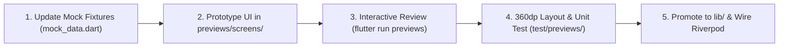

# Eudemonia UI/UX Component Sandbox (Flutter Code-as-Design)

This skill governs the UI/UX modification, redesign, and rapid prototyping lifecycle in the Eudemonia codebase. It enforces an architectural separation between exploratory UI iteration and production code.

---

## 1. Core Architectural Guardrails

### A. Strict Sandbox Isolation (`previews/`)
- All exploratory UI/UX design, visual redesigns, mock data experiments, and layout modifications requested by the user **must take place in `previews/`**.
- **Never introduce prototype boilerplate, mock datasets, or preview scenario switchers into production (`lib/`)**.

### B. Pure Presentational Widget Contract
- Presentational widgets in `lib/` must remain pure: accept primitive models/values and callback closures.
- **Never** make direct calls from presentational widgets to native platform channels (`MethodChannel`), local databases (`Isar`), or heavy AI models (`sherpa_onnx`, `llama_cpp_dart`).
- This guarantees widgets can be rendered, tested, and hot-reloaded instantly in `previews/` without booting backend services or native dependencies.

---

## 2. Directory Layout

```
previews/
├── main_preview.dart     # Standalone launcher: flutter run -t previews/main_preview.dart
├── mock_data.dart        # Typed mock datasets for all edge cases & stages
├── preview_theme.dart    # Theme tokens (colors, radii, spacing)
├── gallery_shell.dart    # Multi-stage gallery & Pipeline HUD container
└── screens/              # Dedicated screen prototypes
    ├── capture_screen_preview.dart
    ├── synthesis_screen_preview.dart
    ├── insights_screen_preview.dart
    ├── action_screen_preview.dart
    ├── settings_preview.dart
    ├── note_merge_preview.dart
    └── note_ejection_preview.dart
```

---

## 3. The 5-Step Prototyping & Promotion Workflow



### Step 1: Update Mock Fixtures
- When a new UI feature or state is needed (e.g. new status colors, new modal parameters, folder manifestos), define typed models and deterministic fixtures in `previews/mock_data.dart`.
- Verify fixture properties in `test/previews/preview_mock_data_test.dart`.

### Step 2: Prototype UI in `previews/screens/`
- Build or edit the screen preview using `PreviewTheme` tokens.
- Add descriptive `Key` annotations to interactive buttons, dropdowns, and cards (e.g., `Key('merge_button_$cleanSeq')`).
- Keep actions self-contained with mock callbacks and local `setState` state transitions.

### Step 3: Interactive Visual Verification
Launch the standalone preview runner:
```bash
~/flutter/bin/flutter run -t previews/main_preview.dart -d macos # or chrome / emulator
```
- Validate layout aesthetics, tap responses, animations, and zero-suppression badges.

### Step 4: Narrow Viewport & Widget Testing
Add component widget tests to `test/previews/preview_screens_test.dart`:
- Verify screen renders without framework assertions.
- Verify actions (tap, dropdown select, modal open/close, edit text, delete).
- Explicitly test on 360dp mobile viewport to guarantee 0 `RenderFlex` overflows:
  ```dart
  tester.view.physicalSize = const Size(360 * 2, 800 * 2);
  tester.view.devicePixelRatio = 2.0;
  addTearDown(() => tester.view.resetPhysicalSize());
  ```

### Step 5: Promotion to Production (`lib/`)
Once visually approved by the user:
1. Promote presentational widgets into `lib/features/<feature>/presentation/`.
2. Connect Riverpod state notifiers/providers for real runtime data.
3. Keep production models clean without prototype mock fixtures.
4. Add production widget tests under `test/features/<feature>/`.

