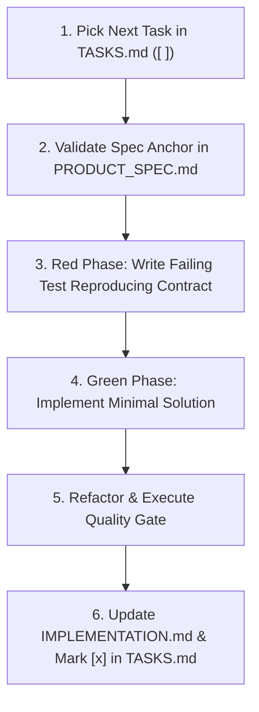

# Eudemonia Task Lifecycle & TDD Engineering Standard

This skill defines the development contract for formulating, picking up, implementing, verifying, and completing atomic tasks in the Eudemonia codebase.

---

## 1. Core Operating Principles

1. **One Atomic Task at a Time**: Never conflate multiple unrelated tasks or let scope creep beyond the task's defined boundary.
2. **Strict Specification Anchoring**: Every task references a stable semantic heading anchor in [`PRODUCT_SPEC.md`](file:///Users/harshmavani/Documents/Eudemonia/PRODUCT_SPEC.md) (e.g. `[PRODUCT_SPEC.md#fr11-synthesis-predefined-folders--session-clustering](./PRODUCT_SPEC.md#fr11-synthesis-predefined-folders--session-clustering)`). Never use line numbers (`#L...`), which break upon editing.
3. **Out-of-Scope Protection**: Consult `PRODUCT_SPEC.md#b-out-of-scope-explicit-non-goals-for-v10` before creating or implementing tasks. Never invent unapproved capabilities.
4. **`IMPLEMENTATION.md` is a Living Blueprint**: Whenever you introduce new architectural patterns, refactor subsystems, or fix bugs, update [`IMPLEMENTATION.md`](file:///Users/harshmavani/Documents/Eudemonia/IMPLEMENTATION.md) to keep documentation synchronized with code.

---

## 2. Task Creation & Backlog Maintenance Standards (`TASKS.md`)

When creating or adding new tasks to [`TASKS.md`](file:///Users/harshmavani/Documents/Eudemonia/TASKS.md), agents **must strictly follow these rules**:

### Rule 1: Strict Spec Alignment (No Hallucinations)
- The `Spec` link **must** point directly to the relevant requirement heading in [`PRODUCT_SPEC.md`](file:///Users/harshmavani/Documents/Eudemonia/PRODUCT_SPEC.md) using stable semantic heading anchors (e.g., `[PRODUCT_SPEC.md#fr1-hardware-key-trigger--volume-safety](./PRODUCT_SPEC.md#fr1-hardware-key-trigger--volume-safety)`).
- Avoid brittle line numbers (`#L...`), which break whenever the specification document is edited.
- **Never invent requirements not grounded in the specification.** Every task must have direct traceability to an approved requirement in `PRODUCT_SPEC.md`.

### Rule 2: Never Create Out-of-Scope Tasks
- Consult [`PRODUCT_SPEC.md#b-out-of-scope-explicit-non-goals-for-v10`](file:///Users/harshmavani/Documents/Eudemonia/PRODUCT_SPEC.md#b-out-of-scope-explicit-non-goals-for-v10).
- Never create tasks for out-of-scope features (e.g., cloud sync, multi-tag graphs, streaming transcription, iOS, raw system prompt editing).
- If a new capability is genuinely needed, update `PRODUCT_SPEC.md` first through explicit user alignment before adding tasks to `TASKS.md`.

### Rule 3: Structured Verification Breakdown
Every task's `Verification` section **must** contain explicit sub-sections:
- **Unit Tests**: Test file path and specific bulleted test cases covered.
- **Widget Tests**: Test file path and specific interaction/rendering test cases covered (or `N/A - Non-UI component`).
- **Integration / Command Tests**: Exact CLI verification command (e.g., `flutter test`, `./gradlew :app:testDebugUnitTest`).

### Rule 4: Task Atomicity & Execution Boundaries
- Keep tasks scoped to single atomic units of work so any agent or developer can execute one task from start to finish without scope creep.
- Group active milestone tasks at the top of `TASKS.md`. When milestones are complete, archive them to `TASKS_archive.md`.

### Rule 5: Descriptive Semantic Headings Rule
- When creating or updating any heading (`##`, `###`, `####`), the title **must explicitly describe the domain, capabilities, and concepts covered**. Never use vague single-word headings.

---

## 3. The 6-Stage Task Execution Loop



### Stage 1: Task Pickup
- Open [`TASKS.md`](file:///Users/harshmavani/Documents/Eudemonia/TASKS.md).
- Locate the next atomic task with status `[ ]`.
- Transition the status to `[/]` (In Progress).

### Stage 2: Spec Anchor Verification
- Check the `Spec` link in the task description.
- Use wildcard heading search (`grep -E -n "^#{2,4} " PRODUCT_SPEC.md`) to locate the requirement and bounded line-range reading to review the functional/non-functional requirements.
- Verify that the work does not touch out-of-scope non-goals.

### Stage 3: Red Phase (Failing Test First)
- **Feature Addition**: Write a unit or widget test defining the expected behavioral contract before writing production code.
- **Bug Fix**: Write a minimal reproducing test that fails under the existing implementation.
- **Crucial Rule on Test Doubles (Mocks/Fakes)**:
  - Never use unconditional stubs that blindly return dummy data.
  - All test doubles for lifecycle-managed services (STT, LLM, audio queues, database) **must enforce lifecycle state** (e.g., throw a `StateError` if invoked prior to initialization or after eviction).

### Stage 4: Green Phase (Minimal Implementation)
- Write the minimal production code necessary to satisfy the test contract.
- Keep presentational widgets pure (primitives + callbacks).
- Provide failure isolation: if a background queued item fails, log the error, mark it failed, and continue processing remaining items.

### Stage 5: Refactor & Quality Gate
- Refactor code cleanly while keeping tests green.
- Activate the `eudemonia-quality-gate` skill:
  1. `~/flutter/bin/dart analyze` (Assert 0 errors, 0 warnings).
  2. `~/flutter/bin/flutter test <affected_test_file>.dart`
  3. Verify 360dp narrow viewport rendering without `RenderFlex` overflows.
  4. `~/flutter/bin/flutter test` (Full regression pass).

### Stage 6: Documentation & Task Completion
1. **Update `IMPLEMENTATION.md`**: Record new subsystem mechanics, prompt schemas, or historical lessons learned in the appropriate section.
2. **Update `TASKS.md`**: Mark the task as completed:
   ```markdown
   - [x] **TASK-XXX: ...**
   ```
   Ensure the `Verification` section has all unit tests, widget tests, and exact CLI commands recorded.
