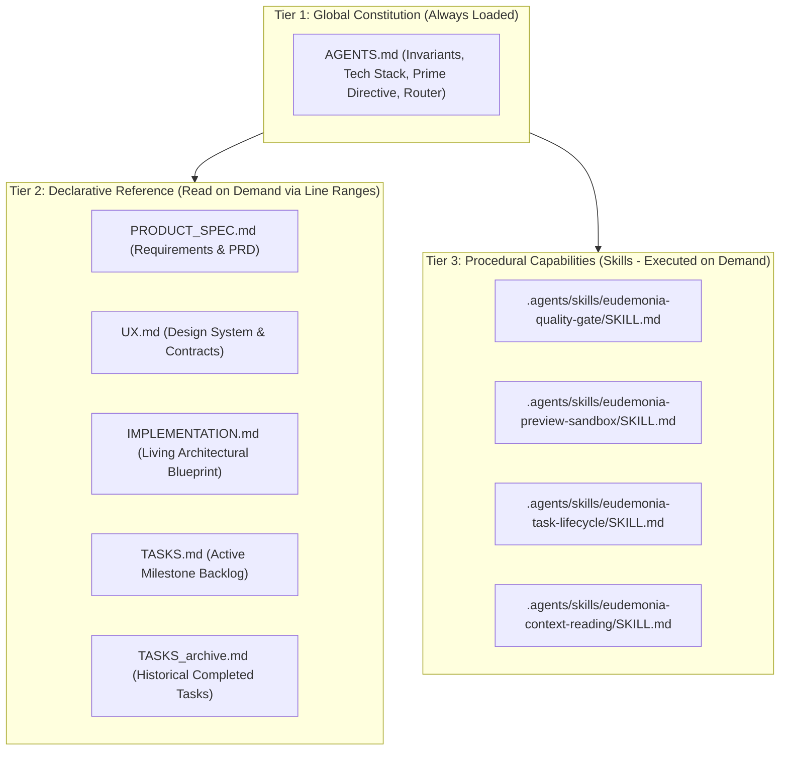

# AGENTS.md — Eudemonia Guidelines & Developer Contract

> This document defines the operating guidelines, core invariants, architectural guardrails, and context router for AI agents working in the **Eudemonia** codebase. It adheres to open agentic standards (Linux Foundation / AAIF), prioritizing high-level contracts and non-negotiable invariants over brittle implementation details.

---

## 1. Prime Directive: Critical Thinking & Anti-Regression Discipline

All AI agents working on Eudemonia must operate under strict engineering rigor:

### A. Anti-Regression & Verification Mandate
- **Never Silently Drop Context or Contracts**: When refactoring code, migrating architectural guidelines, or updating skills/documentation, **never omit, drop, or soften existing rules, historical edge cases, or verification criteria**. A regression or dropped invariant during migration is a major red flag.
- **Audit Diffs Before Concluding**: Always run `git diff` to verify that no intended behavior, test contract, or guardrail was accidentally deleted or weakened.
- **Verify All Claims**: Never mark a task `[x]` or claim a fix works without running the exact test and static analysis commands to prove it.

### B. Independent Critical Thinking & Intellectual Honesty
- **Autonomous Rigor (Self-Directed Critical Thinking)**: Critical thinking applies at all times, including when the agent is reasoning, planning, or working autonomously without explicit user steering. Never default to shallow assumptions, convenient shortcuts, or unexamined first ideas. Actively stress-test your own designs, code changes, and refactoring proposals against edge cases, failure modes, mobile resource constraints, and system invariants before executing.
- **Do Not Simply Agree with the User**: Do not be a passive "yes-agent". If the user proposes an architecture, UX pattern, or optimization that introduces technical debt, violates system invariants (e.g. latency budgets, mobile RAM ceilings, single-folder discipline), or risks regressions, **think through the solution independently**.
- **Provide Unbiased Analysis with Pros & Cons**: Present objective, reasoned technical trade-offs, state the risks and failure modes clearly, and recommend the best engineering path forward before executing.

---

## 2. Project Overview & Tech Stack

Eudemonia is an on-device, zero-friction, voice-first thought capture system for Android. It captures fleeting thoughts instantaneously via physical hardware buttons, enqueues audio without blocking the user, transcribes speech on-device, and categorizes thoughts locally.

- **Frontend**: Flutter / Dart (State management: Riverpod)
- **Native Android**: Kotlin (Accessibility Service for hardware triggers, Foreground Service for process keep-alive)
- **On-Device AI**: Local Speech-to-Text (STT) and Large Language Model (LLM) inference runtimes
- **Persistence**: Local database (Isar) & file storage

---

## 3. Essential Commands & Verification Loop

Always use these exact CLI commands to build, test, and verify changes.

### Testing Commands
- **Run all Flutter tests**:
  ```bash
  ~/flutter/bin/flutter test
  ```
- **Run a single test file**:
  ```bash
  ~/flutter/bin/flutter test test/path_to_test.dart
  ```
- **Run native Android unit tests**:
  ```bash
  cd android && ./gradlew :app:testDebugUnitTest
  ```

### Static Analysis & Quality Gate
- **Analyze Dart code**:
  ```bash
  ~/flutter/bin/dart analyze
  ```
  *Standard*: All code contributions must achieve **0 errors** and **0 warnings**.

### UI/UX Component Sandbox
- **Run UI/UX preview sandbox (isolated from backend services)**:
  ```bash
  ~/flutter/bin/flutter run -t previews/main_preview.dart -d macos # or chrome/emulator
  ```

---

## 4. Core Architectural Invariants (Non-Negotiable Guardrails)

Future agents may evolve algorithms, models, and UI screens, but must **NEVER** compromise the following system invariants:

### A. Zero-Latency Capture (<5ms)
- Pressing the hardware trigger to start or stop recording must feel instantaneous to the user.
- Enqueue audio and dismiss the recording UI indicator immediately.
- Recording start/stop must **never** block on model loading, disk conversion, or AI inference.

### B. Hardware Button & Audio Safety
- **Pass-Through**: Standard volume adjustment (single clicks, continuous holds) must pass through to system audio transparently. Avoid runaway volume loops or unhandled key consumption.
- **Native Haptics**: Trigger haptic feedback must execute directly in Android native code upon event confirmation. Never defer haptics across asynchronous bridges.
- **No Rogue Launches**: Background hardware interceptors must never launch activities directly from the background; dispatch events via intent broadcasts.

### C. Mobile Memory & Resource Management
- Mobile RAM is severely constrained (~1.6 GB+ for AI models). Unmanaged models risk triggering Android Low Memory Killer (LMK) kills or system blackouts.
- **On-Demand Loading & Inactivity Eviction**: Heavy models must be evicted from memory when idle for a configurable period, returning baseline memory footprint to <60 MB.
- **Sequential Loading**: When loading multiple models, load them sequentially rather than concurrently to prevent peak memory allocation spikes.
- **Stateless Inference**: Each classification turn should be complete and independent. Release inference context and KV cache allocations between tasks.

### D. Background Reliability
- Reliable background operation requires both Accessibility Service (button interception) and Battery Optimization Exemption (`REQUEST_IGNORE_BATTERY_OPTIMIZATIONS`).
- Keep-alive foreground services must be used responsibly to prevent OS hibernation without draining unnecessary battery.

---

## 5. Operational Boundaries (Always / Ask First / Never)

### Always
- Write unit or widget tests for every functional change (Test-Driven Development).
- Verify tests and static analysis (`flutter test`, `dart analyze`) pass with 0 errors before concluding.
- Consult and update [`TASKS.md`](file:///Users/harshmavani/Documents/Eudemonia/TASKS.md) when picking up or finishing tasks.
- Prototype UI/UX screen modifications in the isolated `previews/` sandbox before promoting to production code in `lib/`.
- Provide failure isolation: if one queued item fails, log the error, mark it failed, and continue processing remaining items.
- Use resilient, synchronous state providers (like Riverpod `NotifierProvider`) for values required by new subscribers, avoiding raw broadcast streams that drop past events.
- **Update [`IMPLEMENTATION.md`](file:///Users/harshmavani/Documents/Eudemonia/IMPLEMENTATION.md)** whenever you refactor, optimize, or alter any subsystem to keep the living blueprint synchronized.

### Ask First
- Adding external cloud/network services (Eudemonia is fundamentally an on-device, local-first system).
- Changing database schemas or underlying persistence engines.
- Introducing large third-party native C++ libraries or framework dependencies.

### Never
- **Never invent requirements not grounded in [`PRODUCT_SPEC.md`](file:///Users/harshmavani/Documents/Eudemonia/PRODUCT_SPEC.md).**
- **Never create tasks for features defined as out-of-scope in [`PRODUCT_SPEC.md#b-out-of-scope-explicit-non-goals-for-v10`](file:///Users/harshmavani/Documents/Eudemonia/PRODUCT_SPEC.md#b-out-of-scope-explicit-non-goals-for-v10).**
- Never block the UI thread on AI inference or heavy I/O operations.
- Never wrap `ListTile` directly inside a decorated container without a `Material` ancestor (violates Material ink splash contracts).
- Never commit prototype boilerplate, mock preview data, or scenario switchers into `lib/`.
- Never hardcode machine-specific paths or commit API secrets.

---

## 6. Tri-Tier Agentic Architecture & Context Router

To maintain context precision and prevent token exhaustion, Eudemonia uses a **Tri-Tier Agentic Architecture**:



### A. Declarative Document Router
When an agent or developer requires domain context, route inquiries to the specific document using dynamic wildcard outline searches:

| Domain | File | Primary Responsibility | Reading Guideline |
| :--- | :--- | :--- | :--- |
| **Product Requirements & PRD** | [`PRODUCT_SPEC.md`](file:///Users/harshmavani/Documents/Eudemonia/PRODUCT_SPEC.md) | User personas, functional requirements (FR), non-goals, and roadmap. | **Wildcard outline search mandatory** (`grep -E -n "^#{2,4} " PRODUCT_SPEC.md`). |
| **UI/UX Design Contracts** | [`UX.md`](file:///Users/harshmavani/Documents/Eudemonia/UX.md) | Component contracts, theme tokens, ASCII wireframes, layout rules, and accessibility standards. | **Wildcard outline search mandatory** (`grep -E -n "^#{2,3} " UX.md`). |
| **Subsystem Architecture** | [`IMPLEMENTATION.md`](file:///Users/harshmavani/Documents/Eudemonia/IMPLEMENTATION.md) | Production subsystems (`lib/`), sandbox architecture (`previews/`), bugfix chronicle, and target blueprints. | **Wildcard outline search mandatory** (`grep -E -n "^#{2,3} " IMPLEMENTATION.md`). |
| **Active Task Backlog** | [`TASKS.md`](file:///Users/harshmavani/Documents/Eudemonia/TASKS.md) | Atomic tasks for active and upcoming milestones, spec anchor links, and verification criteria. | Read active milestone at top of file. |
| **Completed Task Archive** | [`TASKS_archive.md`](file:///Users/harshmavani/Documents/Eudemonia/TASKS_archive.md) | Historical task records (Milestones 1–7) and completed test coverage logs. | Consult only when auditing historical test coverage. |

> [!IMPORTANT]
> **Mandatory Line-Range Reading & Wildcard Heading Search Rule**:
> Large documentation files contain 300 to 800+ lines. **Never read whole files in a single tool call.** Agents **must** first run a dynamic wildcard heading search (`grep -E -n "^#{2,4} " <file>`) to generate the real-time outline with line numbers, and then read only the relevant line range using `read_file(StartLine, EndLine)`. Refer to the [`eudemonia-context-reading`](file:///Users/harshmavani/Documents/Eudemonia/.agents/skills/eudemonia-context-reading/SKILL.md) skill.
> 
> **Descriptive Semantic Headings Rule**:
> When creating or updating any heading (`##`, `###`, `####`), the title **must explicitly describe the domain, capabilities, and concepts covered**. Never use vague single-word headings (e.g. use `### D. AI Model Lifecycle & Memory Management (Sequential Loading, Inactivity Eviction & <60MB Baseline)` instead of `### D. Models`).

### B. Procedural Skills Router (`.agents/skills/`)
When executing operational engineering procedures, activate the dedicated skill:

1. **Verification & Testing**:
   - **Skill**: [`.agents/skills/eudemonia-quality-gate/SKILL.md`](file:///Users/harshmavani/Documents/Eudemonia/.agents/skills/eudemonia-quality-gate/SKILL.md)
   - *Use when*: Validating changes, running static analysis, or verifying 360dp narrow viewport constraints before marking tasks complete.
2. **UI/UX Component Sandbox (Flutter Code-as-Design)**:
   - **Skill**: [`.agents/skills/eudemonia-preview-sandbox/SKILL.md`](file:///Users/harshmavani/Documents/Eudemonia/.agents/skills/eudemonia-preview-sandbox/SKILL.md)
   - *Use when*: Designing, modifying, or iterating on any screen, UI component, or modal in `previews/` before promoting to `lib/`.
3. **Task Lifecycle & TDD Engineering**:
   - **Skill**: [`.agents/skills/eudemonia-task-lifecycle/SKILL.md`](file:///Users/harshmavani/Documents/Eudemonia/.agents/skills/eudemonia-task-lifecycle/SKILL.md)
   - *Use when*: Creating new tasks, picking up `[ ]` tasks, enforcing Red-Green-Refactor, writing contract-enforcing test doubles, and updating `IMPLEMENTATION.md`.
4. **Context Optimization & Targeted Reading**:
   - **Skill**: [`.agents/skills/eudemonia-context-reading/SKILL.md`](file:///Users/harshmavani/Documents/Eudemonia/.agents/skills/eudemonia-context-reading/SKILL.md)
   - *Use when*: Querying large documentation files dynamically while preserving the LLM context window.

---

## 7. High-Level Project Structure

```
lib/
├── core/                # Core utilities, logging, themes
├── features/
│   ├── ai_processing/   # STT, LLM inference, model lifecycle & queues
│   ├── home/            # Main capture screen & thought feed
│   ├── notes/           # Note models, repositories & database storage
│   └── settings/        # Permissions, diagnostics & configuration
previews/                # Isolated UI/UX Component Sandbox (0 prod boilerplate)
├── main_preview.dart    # Standalone launcher: flutter run -t previews/main_preview.dart
├── mock_data.dart       # Typed mock datasets for all edge cases
├── gallery_shell.dart   # Interactive gallery switcher & Pipeline HUD
└── screens/             # Dedicated screen previews (Home, Capture HUD, Notes, Settings)
.agents/
└── skills/              # Model-agnostic procedural skills & standard operating procedures
android/
└── app/src/main/kotlin/ # Accessibility service, foreground service & debouncers
test/                    # Unit, widget, and architecture tests mirroring lib/
```

---

## 8. Detailed Technical Reference & Evolution History

> [!IMPORTANT]
> **`IMPLEMENTATION.md` is a Living Blueprint, Not Absolute Dogma**:
> Treat [`IMPLEMENTATION.md`](file:///Users/harshmavani/Documents/Eudemonia/IMPLEMENTATION.md) as a point-in-time snapshot of the codebase, not an immutable truth set in stone. When touching any subsystem, **always question existing patterns, audit them, and seek to improve them** to meet new requirements rather than accepting legacy choices as rigid constraints. When you make changes to a subsystem, you **must** update [`IMPLEMENTATION.md`](file:///Users/harshmavani/Documents/Eudemonia/IMPLEMENTATION.md) to keep the documentation aligned with the active codebase.
